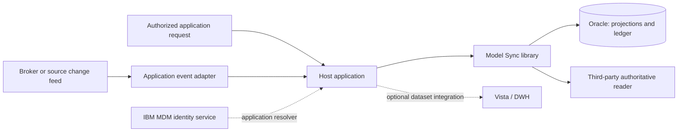
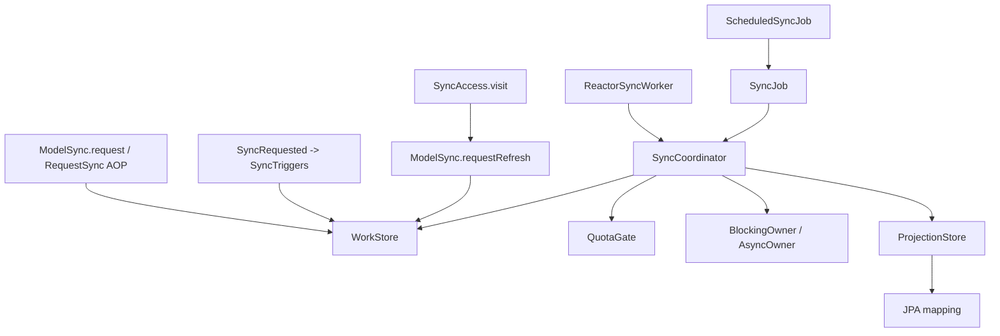
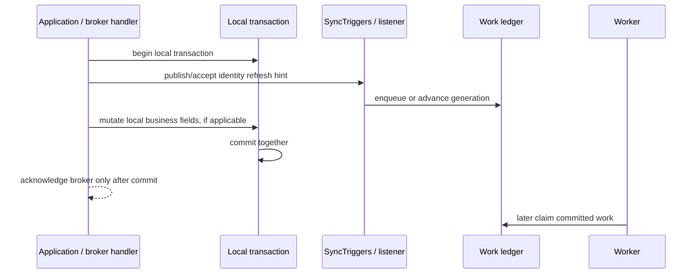
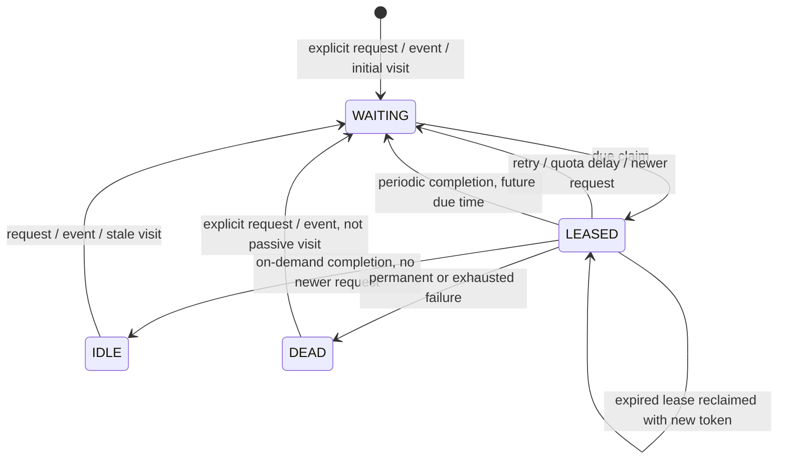
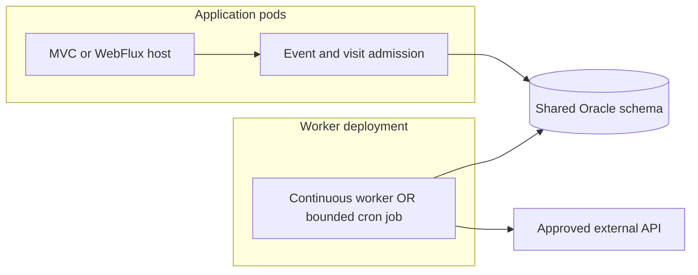

## Current acceptance record — 2026-10-26

The [acceptance matrix](quality/ACCEPTANCE-MATRIX.md) is the current requirement-level
status. Accepted named-target full source `a0f46d7` remains unchanged. Independent
local MVC/WebFlux consumption at source `551427b` is PASS. Completed execution
leaves are closed; production remains NO-GO with specific open subcriteria in the
matrix. Dated entries below retain their historical scope/status and are not new tasks.

# Model Sync — arc42 architecture

**Document edition:** trigger extension, 2026-10-20.
**Repository baseline reviewed:** `Tobia5/model-sync-starter` at `a555ffaf8681b6dcc2597f16a84bf5b2a45c11d6`.
**Status:** implemented reference architecture with explicit, outstanding production release gates. This is not a production certification. Read [the validation report](REVIEW.md) before approving deployment.

This document follows the twelve arc42 sections. The design is specific to the code in this repository, not a copied generic template. [The user handbook](USER-HANDBOOK.md) contains setup and usage; [the production runbook](PRODUCTION.md) contains migration, recovery and release acceptance. Earlier documents remain useful deep dives, but this edition supersedes their statements about trigger availability and recurrence.

## 1. Introduction and goals

### 1.1 Purpose and requirements

Model Sync maintains local projections of externally authoritative records. A host application defines a typed `ModelBinding<T>` describing an owner reader, local projection, ownership boundary, semantic digest, quota and freshness policy. The starter records work durably and reconciles it outside caller transactions. It does not transfer ownership to the cache.

The principal use case is a large Oracle/JPA population, potentially millions of subjects, whose owner exposes a rate-limited REST API. Identity can be resolved through an IBM MDM adapter; analytical consumers can use dataset contracts for Vista or a data warehouse. Product-specific clients and the interpretation of their data are application integrations, not implemented vendor connectors.

| Requirement | Implemented route / boundary |
|---|---|
| R1: request synchronization without making the business request wait for an owner | `ModelSync.request`, `SyncTriggers.accept`, durable `WorkStore` |
| R2: support scheduled execution | `SyncJob`, optional `ScheduledSyncJob`; bounded drain of known work |
| R3: accept change signals | `SyncRequested`, optional synchronous Spring listener; broker-specific reception remains external |
| R4: check age on a visit | `SyncAccess.visit`, explicit serving decision and passive refresh admission |
| R5: avoid polling unused caches | per-binding `RefreshMode.ON_DEMAND`, persistent `IDLE` work state |
| R6: respect authority and prevent stale completion | local repair opt-in, digest checks, revision checks and lease fencing |
| R7: keep Spring MVC, WebFlux and headless usage possible | framework-neutral core, blocking/asynchronous owner ports, Reactor bridges |

### 1.2 Quality goals, in priority order

1. **Integrity:** a failed local transaction must not leave a completed ledger result or a partially applied projection; an obsolete lease must not complete newer work.
2. **Bounded load:** all trigger paths converge on the same request budget; hot visits must not reset provider cooldown, defeat retry backoff or revive quarantined work.
3. **Truthful serving:** expired, unverified or mismatching data must not be returned as trusted by the visit facade; a ticket is not proof of completion.
4. **Operability:** execution mode, freshness policy, schema compatibility, failures and release evidence must be explicit.
5. **Replaceability:** application mappings and owner clients are beans/ports; the core must not depend on Spring, Reactor or persistence libraries.

### 1.3 Stakeholders and responsibilities

| Role | Responsibility and expectation |
|---|---|
| Application team | Owns DTOs, mapping, tenant authorization, owner client, binding identifiers and user-facing pending responses |
| External owner / integration team | Specifies quota unit, identity keys, ETag semantics, retry rules, authentication and source discovery |
| DBA / platform operations | Owns migration, database access, pool sizing, backups, recovery and Oracle contention qualification |
| Security / privacy reviewer | Reviews data fields, secrets, remote destinations, identity exposure, retention and deletion requirements |
| Analytics team | Defines snapshot/grain/filter agreement, downstream acknowledgement and reconciliation coverage |
| Library maintainers | Preserve contracts, tests, versioned schema and compatibility documentation |

These are required roles, not a claim that named production approvers have already accepted the release.

## 2. Architecture constraints

The baseline pins Java 21 and Spring Boot BOM `4.1.1`. This update retains those coordinates; it does not establish artifact availability, compatibility or vulnerability status. A dependency-enabled Maven build is a release gate.

The first production persistence target is Oracle. JPA manages business projections; JDBC manages coordination. Both must enlist in the same local transaction and the same datasource. XA, separate ledger databases and remote target writes are not implicitly supported by that atomicity model. Hibernate entities do not cross thread boundaries; immutable snapshots do.

Provider rate limits are hard external constraints. A reactive client changes thread utilization, not the number of calls the provider permits. A custom adapter that performs several physical calls must account for all of them; the built-in owner boundary admits one invocation, not an unknowable call graph.

No DDL is applied automatically by the production starter. Fresh installations can provision v2. Existing v1 supports periodic operation; on-demand use requires v2 and a reviewed migration. H2 tests cannot certify Oracle cursor locking, drivers, isolation or DDL.

The update is distributed as a patch/overlay because GitHub write access was rejected by the integration. It must not overwrite unrelated repository files or revert the user's formatting changes.

## 3. Context and scope

The **library boundary** includes model registration, intent admission, queue state, planning, comparison, completion and execution adapters. The **host boundary** includes authentication, tenant permissions, HTTP endpoints, broker subscription, identity translation, DTO validation, data discovery and business semantics.

A `SubjectKey(tenant, id)` is scoped by its `WorkKey(binding, subject)`. It is not a global MDM identifier and is not itself an authorization grant. The owner adapter decides how a subject maps to a source identifier. Applications requiring merge/split handling need a durable, versioned identity mapping and a quarantine path for ambiguity.

`gateway.boundaryModels("cards")` enumerates locally registered model types/routes. `BoundaryInventory` is a port for remote catalogs and paged subject enumeration; a restart-safe inventory importer is still application work. Neither a cron run nor a visit discovers records that have never been registered or requested.

Vista/DWH contracts are analytical boundaries, not alternate authorities for operational customer fields. Their adapters must define snapshot ID, cutoff, grain, filters, transformations and coverage. A batch accepted by a target is not proof that it is visible and reconciled there.

## 4. Solution strategy

Separate three dimensions that are often incorrectly collapsed into one “sync mode”:

| Dimension | Choices | Meaning |
|---|---|---|
| Admission trigger | explicit request, source event, visit | Why a subject needs work |
| Execution | continuous Reactor worker, bounded job, explicit `runOne()` | Who drains committed work |
| Recurrence | `PERIODIC`, `ON_DEMAND` | Whether completion schedules the next background refresh |

An event or visit does **not** execute the external call. At least one worker/job deployment must consume the queue. Conversely a job drains due work; it is not a full source scan.

Retain `PERIODIC` as the compatibility default. Use `ON_DEMAND` for caches that should become idle after processing and wake only on a subsequent event/request/stale visit. Both modes retain retry and lease recovery; “on demand” does not mean “one attempt only.”

Explicit requests and passive visits have different admission semantics. An explicit source event can force validation and advance the request generation; a passive visit reuses existing work, preserves retry/cooldown and refuses to revive `DEAD`. This prevents a busy page from repeatedly generating follow-up owner requests while a fetch is already running.

The application opts into local repair; absent owner records are not implicitly deleted. Ownership is defined for a mapped DTO/field set rather than inferred from every property of a JPA entity.

## 5. Building block view

### 5.1 Modules and dependency direction

| Module | Responsibility |
|---|---|
| `model-sync-core` | Domain contracts, binding/registry, gateway, planner, trigger facades, job, freshness and priority |
| `model-sync-spring` | Role qualifiers, transactional AOP, synchronous event adapter, cron lifecycle |
| `model-sync-persistence-jdbc` | Durable work/state, database clock, shared quota, Oracle/H2 schemas |
| `model-sync-persistence-jpa` | Application-owned mapping and version-checked local projection writes |
| `model-sync-rest` | Blocking REST owner adapter |
| `model-sync-reactor` | Bounded execution, asynchronous/blocking bridges, lazy reactive visit facade |
| `model-sync-webclient` | Native asynchronous HTTP owner adapter |
| `model-sync-autoconfigure` | Conditional default beans, properties and opt-in adapters |
| Three `model-sync-spring-boot-starter*` modules | Dependency assemblies, not business logic |
| `model-sync-testkit` | Deterministic clock, transactional memory stores and executable contracts |
| `model-sync-sample` | Headless H2/JPA illustration; not a production deployment |

The existing dependency checker verifies an acyclic module graph and prevents framework imports into core. It does not replace binary compatibility or framework linkage tests.

### 5.2 Trigger and runtime components

`ModelSyncTriggerAutoConfiguration` supplies `SyncTriggers` and `SyncJob` when the runtime exists. Its optional listener and scheduler are disabled by default. It rejects simultaneous built-in cron and continuous-worker enablement within one application. Manual/custom execution remains possible and is the host's responsibility.

### 5.3 Durable data

| Table | Role | Critical fields |
|---|---|---|
| `MS_WORK` | Coalesced subject work | binding/tenant/subject, priority, generation, attempts, due time, token, lease expiry, stable error code |
| `MS_STATE` | Last known verification evidence | validated/reconciled timestamps, matched digest, source validator, outcome |
| `MS_QUOTA` | Shared provider admission | quota group, spacing, next permitted admission |
| `MS_META` | Schema compatibility | schema version |

The application owns its projection table and optimistic revision. `MS_STATE` does not retain a full source payload or every historical reconciliation event. The ledger is not an immutable audit journal or remote-delivery outbox.

## 6. Runtime view

### 6.1 Source event and transactional enqueue

The Spring listener declares `supportsAsyncExecution() == false`; it is not an `AFTER_COMMIT` listener. It keeps enqueue on the publisher thread, where an existing local transaction can include the intent. Do not configure a multicaster error handler that swallows enqueue failures. Without a caller transaction, the enqueue commits through the local transaction facade.

A broker consumer must supply its own authentication, acknowledgement and replay policy. Subject coalescing is not event-ID deduplication: redelivery after completion can cause another forced fetch. A durable inbox is necessary where that cost/semantic distinction matters. A transaction that only wraps a broker acknowledgement does not magically enlist Oracle.

### 6.2 Visit and serving decision

| Local evidence at inspection | `STALE_WHILE_REVALIDATE` | `REQUIRE_FRESH` |
|---|---|---|
| Verified and below refresh threshold | Return value, no request | Return value, no request |
| Verified; refresh due but below maximum age and retention expiry | Return snapshot and passive refresh ticket | No value; passive refresh ticket |
| Missing, expired, unverified or different from last matched digest | No value; passive refresh ticket | No value; passive refresh ticket |
| Refresh needed but work is `DEAD` | Do not revive; bounded stale value only when otherwise permitted | No value; suppressed refresh |

The decision performs local I/O only. A hit never resets validation or retention. An empty result is not an authoritative 404. Classification is a snapshot decision, not a linearizable guarantee against a simultaneous update. An event forces a later fetch but does not immediately invalidate the serving snapshot; strict read-after-event consistency would require a generation/version-aware read barrier that is not implemented.

### 6.3 Worker processing and completion

1. A short transaction claims eligible work and records a token/lease.
2. Another short transaction validates ownership, reads state and an immutable local revision/digest. A fresh non-forced match can complete without owner I/O.
3. Outside that transaction, shared quota admission either permits the owner invocation or supplies a retry time. The HTTP transport must enforce its own timeout.
4. Completion obtains the ledger lock first, validates the lease, rechecks the local revision and optionally repairs mapped fields.
5. Projection change and reconciliation evidence commit together. A competing local revision reschedules rather than overwrites it.

A completion with a newer request generation always leaves that work pending. Ordinary visits during a lease do not create a newer generation. `IDLE` means no scheduled refresh, not necessarily a successful match: an authoritative absence or verify-only mismatch can also leave an on-demand item idle with its outcome recorded.

### 6.4 Job execution, failure and restart

`SyncJob.run(maxItems, maxDuration)` drains sequentially until an item limit, elapsed monotonic time budget, empty queue or interruption. Its `attempted` count includes claimed work later deferred or failed. The budget is checked between attempts, not as a hard deadline around a blocking HTTP call. One instance prevents overlapping runs; multiple processes coordinate through database claims.

The cron adapter owns one scheduling thread and uses explicit cron/timezone configuration. It does not maintain a persistent history of missed cron firings. The durable work survives process restart; a later run drains what is due. Stop/restart may leave a lease to expire. A timed-out remote call can still finish at the transport/provider; fencing prevents its obsolete database completion, not the occurrence of that network call.

## 7. Deployment view

API-only pods can disable both worker and cron while sharing the same ledger with an enabled executor deployment. Use identical binding IDs, mappings, quotas and schema-compatible binaries across pods. The library does not persist a mapping-version registry to reject mixed configurations automatically; inconsistent deployments are an operational risk.

The default JDBC configuration uses a database-derived clock for shared timestamps. Synchronize platform clocks as well for HTTP dates, logs and scheduler interpretation. Size persistence threads and connection pools from measured load, not from the number of subjects. Shared quota transactions can require a separately acquired connection; leave headroom and test pool exhaustion.

Run migrations with a separate privileged identity. Runtime identities should have only the DML/access privileges required by the approved schema and clock query. Store provider credentials through the host's secret-management mechanism, never in a binding DTO or checked-in YAML.

Production starts with workers disabled until schema, mappings, quotas, endpoint restrictions and observability are validated. Enable a canary binding/tenant and expand only after evidence passes. See [release gates and deployment](PRODUCTION.md).

## 8. Crosscutting concepts

### 8.1 Authority and identity

A binding is the unit of authority, mapping and policy. A DTO may be reused across routes; class-only lookup rejects ambiguity. The synchronized DTO excludes locally owned fields, and the JPA mapping preserves them. IDs from events or HTTP requests must be authorized before admission. Resolve MDM aliases/merges through a versioned application resolver; do not silently reuse an old identity for a different subject.

### 8.2 Freshness, retention and absence

`validatedAt` records an owner validation, while `reconciledAt` and the matched digest represent local agreement. Freshness is not simply “the row was recently read.” The age bands are fresh before `refreshAfter`, stale from that boundary until `maxAge`, expired at or beyond `maxAge`, and unknown without trustworthy evidence or after clock regression. Projection expiry can reject a value earlier.

For a writable cache, successful repair/touch sets its retention expiry. There is no built-in physical purge, legal-retention engine or sliding idle TTL. A source 404/absence does not imply permission to delete local data. Define an application-owned tombstone policy separately.

### 8.3 Transactions and AOP

All application paths that combine intent and projection mutation must lock ledger before projection. `@RequestSync` enforces this for supported synchronous methods by enqueuing before invoking the business method in a local REQUIRED transaction. Public non-final proxy entry, input identity and no conflicting `@Async`/transaction annotations are required. Self-invocation bypasses Spring advice. The role qualifiers do not provide interception.

Event admission and explicit facade calls are alternatives to AOP. There is deliberately no getter interception, `@PostLoad` HTTP call, generic repository interception or hidden synchronization caused by ordinary JPA reads. This keeps transaction latency and rate-limit admission observable.

### 8.4 Concurrency and backpressure

Request coalescing bounds the number of ledger rows by registered subjects, not by clicks. It does not make the ledger a bounded-capacity system: a flood of distinct untrusted IDs can still grow it, so tenant quotas and admission validation belong at the host boundary.

Priorities use weighted selection, not a strict distributed urgent deadline. Bounded persistence and owner schedulers isolate blocking work in reactive applications. Do not invoke JPA on Netty event-loop threads or share managed entities across threads. One binding invoking several remote services needs separate physical-call budgets.

### 8.5 Security and operational evidence

Do not log source payloads, credentials or full HTTP error bodies. Use stable error categories and low-cardinality metrics. A tenant ID supplied by a caller is not proof of access; application authorization must constrain both reads and enqueues. Defend provider adapters against arbitrary-host URLs/redirects, oversized payloads and uncontrolled retries. Cryptographic digest equality is not a substitute for source authentication.

The repository does not implement a complete Micrometer dashboard, SIEM integration, immutable audit trail, credential rotation workflow or broker inbox. Operators must instrument these requirements and prove their behavior before release. Do not turn dependency-free contract success into a claim about Oracle or Spring transaction enlistment.

## 9. Architecture decisions

| ADR | Decision and rationale | Alternatives / consequence |
|---|---|---|
| ADR-001 | Keep core plain Java and explicit typed bindings | Hibernate callbacks as the engine would hide I/O and miss external-only changes |
| ADR-002 | All triggers feed one durable subject ledger | Independent event/job/visit pipelines would duplicate budgets, retries and correctness rules |
| ADR-003 | Separate passive visits from explicit change requests | Always incrementing generation on read creates repeated work during slow owner calls |
| ADR-004 | Add persistent `IDLE` for on-demand completion | Sentinel far-future dates obscure intent; deleting work would lose state and complicate races |
| ADR-005 | Synchronously enqueue events inside local transactions | Plain after-commit callbacks leave a failure window between business commit and durable intent |
| ADR-006 | Visit returns metadata/pending rather than blocking until refresh | Preserves provider isolation; application must design pending/unavailable UX |
| ADR-007 | Preserve periodic behavior by default | Prevents silently stopping existing deployments; on-demand needs explicit v2 capability |
| ADR-008 | Keep scheduler opt-in and mutually exclusive with built-in continuous worker | Avoids surprising duplicated local execution and ambiguous operational ownership |
| ADR-009 | Keep broker, inventory and vendor adapters outside this change | Avoids claiming exactly-once delivery, completeness or vendor compatibility without protocols |

These decisions are accepted for this reference implementation. Changing an authority key, work identity, schema or serving semantics requires an explicit migration and compatibility review.

## 10. Quality requirements

The following are acceptance criteria and proposed test targets, not measurements of a production installation.

| Scenario | Required response / measurement | Evidence or remaining gate |
|---|---|---|
| 1,000 visits arrive for one missing subject before fetch | One coalesced item; no generation growth from passive visits | Executed memory contracts |
| A passive visit arrives during cooldown/backoff | Preserve next eligible time and attempts | Executed memory contracts; H2 source tests added |
| An owner call fails permanently; users keep visiting | No automatic revival from `DEAD` | Executed memory contracts |
| An event arrives during an active lease | Completion must retain the newer request | Executed memory contracts; JDBC integration test source |
| Failure after projection write but before completion | Roll back projection and evidence together | Memory contract only; actual JPA/JDBC transaction gate remains |
| Old worker returns after lease reclamation | Reject its completion | Memory contract; Oracle concurrent-worker gate remains |
| A record reaches exact maximum age | Return no trusted projection | Executed boundary contracts |
| Spring event multicaster has an executor | This listener still enqueues synchronously | Framework test supplied, not executed locally |
| Native reactive controller calls visit | No local I/O until subscription; use persistence scheduler | Implementation supplied; framework test/build gate |
| Scale to expected millions and restart under load | Stable heap, bounded connection use, acceptable due-queue lag and owner QPS | Production-like load test required; no benchmark claimed |

Capacity planning is arithmetic before tuning: with `N` subjects, `c` calls per full refresh, and `r` available calls/minute, the ideal cycle is `N*c/r` minutes. Five million subjects at 100 calls/minute and one call each take about 34.7 days before retries/reserve. A 30-day full-refresh promise is impossible under those assumptions. Events, visit-only caching, bulk APIs and authoritative deltas can reduce work; more threads cannot increase the contracted budget.

Agree numerical SLOs per binding (serving age, due lag, dead-item threshold, recovery time, API latency and throughput) before release. Alarm on violations rather than silently serving expired records.

## 11. Risks and technical debt

| Risk | Severity / containment |
|---|---|
| Full dependency-enabled build and Spring tests not executed here | Release blocker; run `mvn verify` and record exact JDK/BOM/driver versions |
| Oracle v2 migration and contention unverified | Release blocker; use isolated test schema and interrupted-migration rehearsal |
| No inventory importer/checkpoint orchestration | Cannot claim full-population reconciliation; coverage is known/requested subjects |
| No durable broker inbox | Subject coalescing does not guarantee event deduplication; implement inbox if required |
| No strict read-after-event barrier | Existing snapshot may be served until its normal age limit before refresh; do not use for authorization decisions requiring latest owner state |
| No physical retention cleanup | Application must purge by policy without destroying required identity/ledger evidence |
| Idle-to-periodic policy switch does not awaken idle rows | Bounded explicit re-enqueue required; maintain a change runbook |
| Explicit requests can revive `DEAD` | Authorize operator replays and broker input; avoid unbounded repeated poison events |
| Quota admission is not exact transport arrival time | Measure real remote QPS and reserve headroom; custom multi-call adapters need accurate accounting |
| Visit read and enqueue are separate local transactions | Possible extra non-forced work or snapshot races; no linearizable serving guarantee |
| Mixed mapping versions across pods | Deployment discipline or an application binding-version guard required |
| Original root checksum manifest predates formatting changes | Treat it as historical; use the update manifest and new release provenance |

No high-risk item is closed merely because it is documented. [REVIEW.md](REVIEW.md) states what was actually checked and what still requires execution.

## 12. Glossary

| Term | Meaning |
|---|---|
| Binding | Named route tying model type to owner, local store, field mapping and policies |
| Owner | Authority for the synchronized field set, not necessarily for every field of an entity |
| Replica | Durable local representation of owner data |
| Cache | Local representation with explicit expiry; not the authoritative record |
| Boundary | Logical group of model bindings; not automatic remote discovery |
| Visit | Explicit local read plus a freshness decision and optional durable refresh request |
| Refresh after | Age at which validation is due; not necessarily a hard serving cutoff |
| Maximum age | Age at or beyond which trusted serving is rejected |
| Retention | Projection expiry horizon; physical deletion is a separate application concern |
| Ticket | Stable coalesced subject-work identifier, not a unique completed execution |
| Generation | Counter distinguishing explicit requests that arrive during processing |
| Lease token | Ownership token used to reject completion by obsolete workers |
| IDLE | On-demand item with no automatic future refresh; evidence is retained |
| DEAD | Quarantined item after permanent/exhausted failure; passive visits do not revive it |
| Admission | Permission to begin an owner invocation under the shared quota |
| DWH | Data warehouse; dataset reconciliation must use a declared grain and snapshot |

## Reference basis

The section structure follows [arc42 documentation](https://docs.arc42.org/section-1/). Framework boundaries were checked against [Spring listener execution](https://docs.spring.io/spring-framework/docs/current/javadoc-api/org/springframework/context/ApplicationListener.html), [transaction-bound events](https://docs.spring.io/spring-framework/reference/data-access/transaction/event.html), [Spring proxy behavior](https://docs.spring.io/spring-framework/reference/core/aop/proxying.html), [scheduler lifecycle](https://docs.spring.io/spring-framework/docs/current/javadoc-api/org/springframework/scheduling/concurrent/ThreadPoolTaskScheduler.html) and [Reactor blocking bridges](https://projectreactor.io/docs/core/release/reference/faq.html). These references establish API/design context, not successful linkage of the repository's pinned dependencies.
